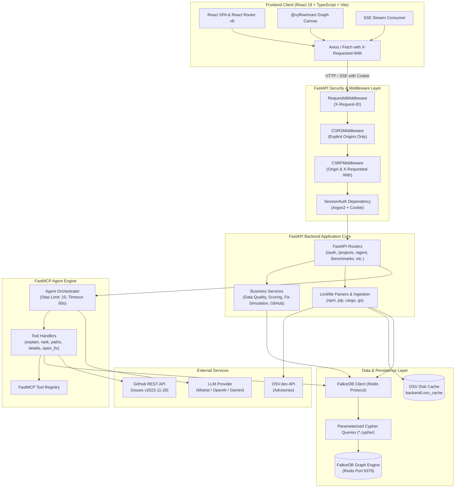
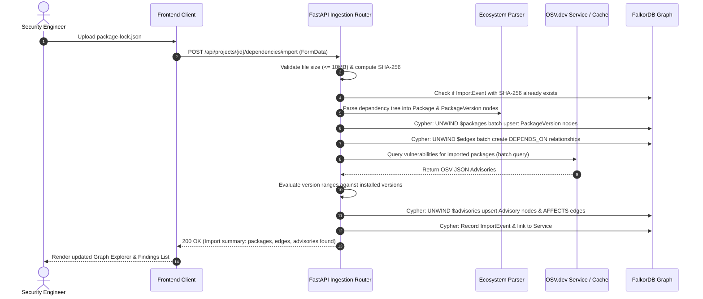
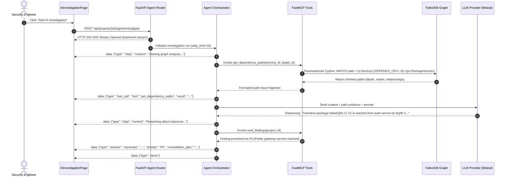
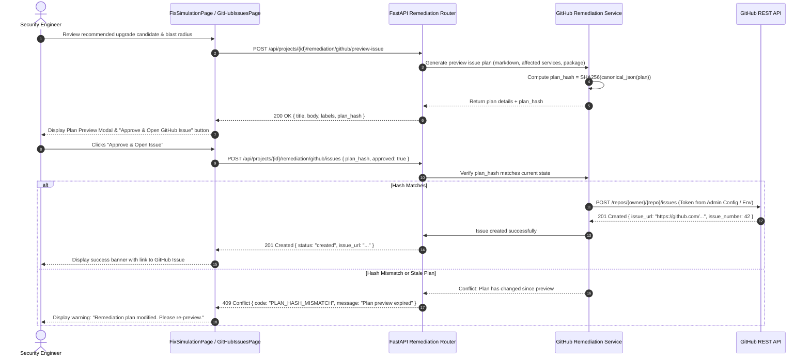

# Vulnify — System Architecture

> **Technical Architecture, Component Design, and Execution Workflows**  
> *A comprehensive deep-dive into the architectural mechanics of Vulnify.*

---

## 1. Architectural Overview

Vulnify is structured as a decoupled client-server platform optimized for high-performance graph traversals, bounded AI reasoning, and verifiable security remediation.



---

## 2. Component Breakdown

### 2.1 Frontend Architecture (`frontend/`)
- **Framework & Tooling**: Built on React 19, TypeScript 5.9, Vite 8.3, and Tailwind CSS v4.
- **Routing**: Managed by React Router v8 with declarative layouts (`AppLayout.tsx`, `SessionLoader.tsx`).
- **Graph Visualization**: Interactive nodes and edges rendered using `@xyflow/react` 12.12. Graph layouts are calculated deterministically in `graphLayout.ts` using topological hierarchy algorithms.
- **State & Contexts**:
  - `ProjectProvider.tsx`: Manages active project selection, switching, and caching across views.
  - `client.ts`: Shared HTTP client configured with credentials (`include`), CSRF headers (`X-Requested-With: vulnify`), and base URL resolution.
- **Streaming UI**: `AiInvestigationPage.tsx` consumes Server-Sent Events (SSE) via native `EventSource` or streaming fetch, dynamically updating thought bubbles, tool executions, and graph path highlights.

### 2.2 Backend Middleware & Security Pipeline (`backend/src/vulnify/main.py`)
Every HTTP request traverses an ordered sequence of Starlette ASGI middleware:
1. **`RequestIdMiddleware`**: Extracts incoming `X-Request-ID` or generates a unique UUIDv4. Injects it into request state, response headers, and structured JSON logging.
2. **`CORSMiddleware`**: Rejects wildcard origins (`*`). Restricts access exclusively to comma-separated domains defined in `ALLOWED_ORIGINS` (default: `http://localhost:5173`). Sets `allow_credentials=True`.
3. **`CSRFMiddleware`**: Protects all state-changing methods (`POST`, `PUT`, `PATCH`, `DELETE`):
   - Enforces the presence and value of the `X-Requested-With: vulnify` header.
   - Validates that the HTTP `Origin` header matches `ALLOWED_ORIGINS`.
4. **Centralized Error Handlers**: Converts internal exceptions into a standardized JSON schema:
   ```json
   {
     "code": "ERROR_CODE_STRING",
     "message": "Human-readable description.",
     "request_id": "req-uuid"
   }
   ```

### 2.3 Authentication & Session Subsystem (`backend/src/vulnify/routers/auth.py`)
- **Password Security**: Uses Argon2id via `argon2-cffi` with high memory and iteration parameters, mitigating GPU-based brute-force attacks.
- **Session Tokens**: JWT-based or signed session cookies (`vulnify_session`) configured with `HttpOnly`, `SameSite=Lax`, and configurable `Secure` flags.
- **Role-Based Access Control (RBAC)**: Distinguishes between `user` and `admin` roles, guarding administrative configurations such as global GitHub tokens and project deletion.

### 2.4 Data Ingestion Pipeline (`backend/src/vulnify/routers/projects.py` & `backend/src/vulnify/version_matching/`)
- **Multi-Ecosystem Parsers**:
  - `npm`: Handles `package-lock.json` schema versions 1, 2, and 3.
  - `python`: Parses `requirements.txt` (standard PEP 508), `Pipfile.lock`, and `poetry.lock`.
  - `cargo`: Parses `Cargo.lock` files, extracting crates and package dependency trees.
  - `golang`: Parses `go.mod` and `go.sum` files.
- **Deduplication & Provenance**: Computes SHA-256 digest of uploaded lockfiles. If identical to a previous import, avoids redundant processing. Creates `(:Service)-[:IMPORTED_FROM]->(:ImportEvent)` nodes.
- **Batch Upserting**: Employs parameterized Cypher unnesting (`UNWIND $batch AS item`) to batch-create package versions and relationship edges in FalkorDB without locking bottlenecks.

### 2.5 OSV Integration & Continuous Caching (`backend/src/vulnify/osv/`)
- Queries the public [OSV.dev REST API](https://api.osv.dev/v1/querybatch).
- Implements concurrency limiting via `asyncio.Semaphore` (default: 5 concurrent requests) and exponential backoff retry policies.
- Caches raw advisory payloads to local disk (`backend/.osv_cache`) keyed by ecosystem and package name, with a default 24-hour TTL.
- Evaluates version ranges against ingested packages using strict native evaluators (`semver` library for npm/cargo and `packaging.version` for PyPI).

### 2.6 Graph Engine & Parameterized Cypher (`backend/src/vulnify/graph/`)
- **Primary Database**: FalkorDB running as a containerized service over the standard Redis wire protocol (`port 6379`).
- **Isolation Model**: Multi-project graph isolation using dedicated graph keys (`vulnify:{project_id}`) or project-scoped property indexing.
- **Query Architecture**: Cypher queries reside in isolated `.cypher` files within `backend/src/vulnify/graph/queries/`. Every parameter is passed safely via query maps; string concatenation is strictly forbidden.
- **Traversal Limits**: Bounded depth constraints (`[:DEPENDS_ON*1..8]`) ensure worst-case exponential explosions cannot freeze the database.

### 2.7 FastMCP Agent Engine (`backend/src/vulnify/agent/`)
- **Model Context Protocol (MCP)**: Exposes tool definitions matching the open MCP specification via `mcp>=2.3.0`.
- **Deterministic Loop**: Hand-written orchestrator (`orchestrator.py`) with hard step limits (default: 10, max: 30) and per-tool execution timeouts (default: 60s).
- **Tool Inventory**:
  - `list_findings`: Lists all unmitigated findings for a project.
  - `get_finding_details`: Retrieves advisory metadata and affected ranges.
  - `get_dependency_paths`: Traces bounded Cypher paths from service entrypoints to vulnerable packages.
  - `rank_findings`: Calculates priority bands based on public reachability and CVSS.
  - `explain_finding`: Synthesizes technical exposure context and remediation guidance.
  - `open_fix_issue`: Previews or commits remediation issues (write-gated).
- **Streaming Updates**: Emits Server-Sent Events (`step`, `tool_call`, `tool_result`, `answer`, `error`) to frontend clients.

### 2.8 Remediation & Human-in-the-Loop Gating (`backend/src/vulnify/services/github_service.py`)
- **Plan Generation**: Constructs structured fix plans including recommended package version, blast radius impact, affected files, and Markdown body.
- **Cryptographic Hash Binding**: Computes `SHA256(canonical_json(plan))`.
- **Authorization Gating**: When a user clicks "Approve & Open Issue" in the UI, the frontend submits the plan along with the previewed hash. The backend recomputes the hash; if mismatched, execution aborts with `HTTP 409 Conflict`.
- **GitHub Dispatch**: Once authorized, dispatches `POST /repos/{owner}/{repo}/issues` using configured fine-grained tokens via GitHub REST API v2022-11-28.

---

## 3. End-to-End Execution Flows

### 3.1 Lockfile Ingestion & Advisory Matching Flow



---

### 3.2 AI Agent Investigation Flow (SSE Streaming)



---

### 3.3 Human-in-the-Loop Remediation Gating Flow



---

## 4. Trust Boundaries & Security Architecture

Vulnify enforces four distinct security trust boundaries:

1. **Client / Network Boundary**:
   - Web frontend communicates with the backend exclusively over TLS/HTTPS (or localhost in dev).
   - Cookies are protected with `HttpOnly` and `SameSite=Lax`.
   - All state mutations require `X-Requested-With: vulnify` and matching `Origin`.
2. **Ingestion & Advisory Boundary**:
   - Manifest files and lockfiles are parsed using sandboxed AST/JSON parsers.
   - Advisory texts from OSV.dev and README descriptions are treated as untrusted data; they are rendered on the frontend exclusively as escaped plain text or structured code blocks, preventing XSS.
3. **Agent & Database Boundary**:
   - The AI agent cannot execute arbitrary SQL/Cypher statements.
   - All database reads occur through static, parameterized `.cypher` files.
   - Variable-length traversals are bounded to a maximum depth of 8.
4. **Remediation & External Write Boundary**:
   - The AI agent cannot write to GitHub or the host filesystem.
   - GitHub API credentials reside server-side in encrypted configurations or environment variables.
   - Every GitHub issue creation is gated behind cryptographic human approval.
