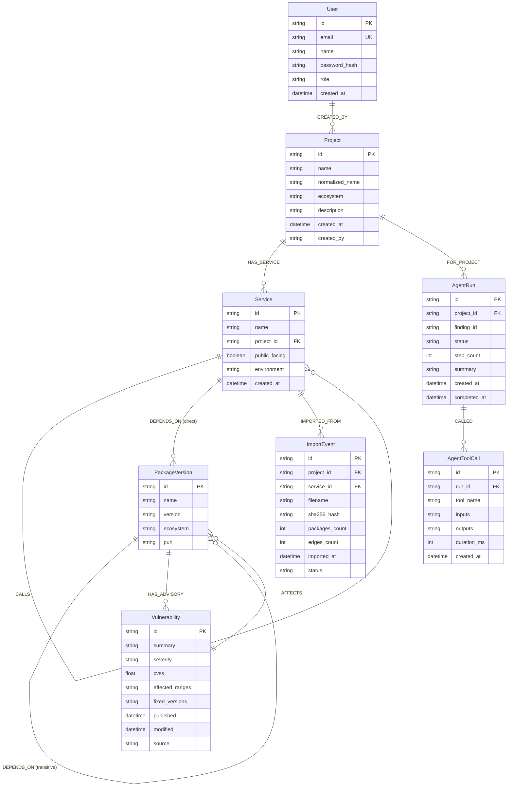

# Vulnify — Database & Data Model

> **FalkorDB Property Graph Schema, Node Specifications, Relationships, and Indexing**  
> *The authoritative architectural specification for data modeling and graph structures in Vulnify.*

---

## 1. Storage Architecture Overview

Vulnify utilizes **FalkorDB** as its primary system of record. FalkorDB is a low-latency graph database engine built on RedisGraph primitives and GraphBLAS sparse-matrix linear algebra.

Unlike traditional relational schemas (which require expensive recursive CTEs for hierarchical dependency chains) or document databases (which duplicate dependency edges across nested records), FalkorDB models software architectures natively as a directed property graph.

### Architectural Exposure Model
Dependency risks are evaluated by matching directed paths from entry services to affected package versions:
```
(:Service)-[:CALLS*0..4]->(:Service)-[:DEPENDS_ON*1..8]->(:PackageVersion)<-[:AFFECTS]-(:Vulnerability)
```

> [!IMPORTANT]
> **Safety and Provenance:** Every relationship edge carries provenance metadata (`origin: manifest|osv|synthetic`), and node identifiers are normalized to prevent collisions across package ecosystems.

---

## 2. Graph Schema & Entity-Relationship Diagram



---

## 3. Node Specifications & Property Catalog

### 3.1 `Project` Node
Represents a top-level software system, organization boundary, or application umbrella.

| Property | Type | Required | Description | Example |
| :--- | :--- | :--- | :--- | :--- |
| `id` | string | Yes | Unique project identifier (UUID or slug). | `prj-ecommerce-prod` |
| `name` | string | Yes | Human-readable project display name. | `E-Commerce Core` |
| `normalized_name` | string | Yes | Lowercased, stripped name for case-insensitive lookup. | `e-commerce-core` |
| `ecosystem` | string | No | Dominant package ecosystem or `multi`. | `npm`, `python`, `cargo` |
| `description` | string | No | Contextual description of the application. | `Production microservices` |
| `created_at` | string | Yes | ISO 8601 creation timestamp. | `2026-10-18T12:00:00Z` |
| `created_by` | string | Yes | User ID who provisioned the project. | `usr-123e4567...` |

---

### 3.2 `Service` Node
Represents an individual deployable unit, microservice, container, or manifest boundary within a project.

| Property | Type | Required | Description | Example |
| :--- | :--- | :--- | :--- | :--- |
| `id` | string | Yes | Unique service identifier. | `srv-auth-service` |
| `name` | string | Yes | Service name as defined in manifest or UI. | `auth-service` |
| `project_id` | string | Yes | Parent project identifier. | `prj-ecommerce-prod` |
| `public_facing` | boolean | Yes | Whether the service exposes an external entry point. | `true` |
| `environment` | string | Yes | Deployment tier: `production`, `staging`, `dev`. | `production` |
| `created_at` | string | Yes | ISO 8601 creation timestamp. | `2026-10-18T12:05:00Z` |

---

### 3.3 `PackageVersion` Node
Represents an exact, immutable release of an open-source software package. Package names alone are insufficient for security matching; exact versions are first-class nodes.

| Property | Type | Required | Description | Example |
| :--- | :--- | :--- | :--- | :--- |
| `id` | string | Yes | Ecosystem-prefixed unique package-version ID. | `npm:lodash@4.17.15` |
| `name` | string | Yes | Package identifier. | `lodash` |
| `version` | string | Yes | Exact semver or PEP 440 version string. | `4.17.15` |
| `ecosystem` | string | Yes | Canonical ecosystem: `npm`, `PyPI`, `crates.io`, `Go`.| `npm` |
| `purl` | string | No | Standardized Package URL (PURL). | `pkg:npm/lodash@4.17.15` |

---

### 3.4 `Vulnerability` (Advisory) Node
Represents a disclosed security vulnerability sourced from OSV.dev, GitHub Advisory Database, or CVE registries.

| Property | Type | Required | Description | Example |
| :--- | :--- | :--- | :--- | :--- |
| `id` | string | Yes | Canonical identifier (GHSA, CVE, or OSV ID). | `GHSA-p6mc-m468-83gw` |
| `summary` | string | Yes | One-line headline describing the vulnerability. | `Prototype pollution in lodash` |
| `details` | string | No | Full advisory description and technical details. | `Affected versions of lodash...` |
| `severity` | string | Yes | Qualitative severity: `CRITICAL`, `HIGH`, `MEDIUM`, `LOW`. | `HIGH` |
| `cvss` | float | No | Numerical CVSS base score (0.0 to 10.0). | `7.4` |
| `aliases` | list[str] | No | Associated CVE or alternative tracking IDs. | `["CVE-2019-10744"]` |
| `affected_ranges` | string | No | JSON-serialized range constraints from OSV. | `[{"type": "ECOSYSTEM", ...}]` |
| `fixed_versions` | list[str] | No | Known non-vulnerable versions remediating this flaw. | `["4.17.21"]` |
| `published` | string | Yes | ISO 8601 publication date. | `2019-07-15T00:00:00Z` |
| `modified` | string | Yes | ISO 8601 last-modified date. | `2021-01-08T00:00:00Z` |
| `source` | string | Yes | Originating advisory authority. | `osv` |

---

### 3.5 `ImportEvent` Node
Maintains immutable audit records for every lockfile or dependency manifest uploaded.

| Property | Type | Required | Description | Example |
| :--- | :--- | :--- | :--- | :--- |
| `id` | string | Yes | Unique import identifier. | `imp-550e8400-e29b...` |
| `project_id` | string | Yes | Target project identifier. | `prj-ecommerce-prod` |
| `service_id` | string | Yes | Target service identifier. | `srv-auth-service` |
| `filename` | string | Yes | Original uploaded manifest file name. | `package-lock.json` |
| `sha256_hash` | string | Yes | Cryptographic hash of file content for deduplication.| `d8e8fca2dc0f896f7c...` |
| `packages_count` | integer | Yes | Number of packages imported. | `242` |
| `edges_count` | integer | Yes | Number of dependency relationships created. | `315` |
| `imported_at` | string | Yes | ISO 8601 timestamp of upload. | `2026-10-18T13:00:00Z` |
| `status` | string | Yes | Processing status: `success`, `failed`, `pending`. | `success` |

---

### 3.6 `AgentRun` and `AgentToolCall` Nodes
Stores complete execution histories of AI investigation runs for auditing and UI trace drawer replay.

- **`AgentRun`**:
  - `id`: Unique investigation run ID.
  - `project_id`: Scoped project identifier.
  - `finding_id`: Target finding under investigation.
  - `status`: `running`, `completed`, `failed`, `timeout`.
  - `step_count`: Total iterations taken.
  - `summary`: Final synthesized conclusion.
- **`AgentToolCall`**:
  - `id`: Unique tool call identifier.
  - `run_id`: Parent `AgentRun` foreign key.
  - `tool_name`: Name of FastMCP tool invoked (`get_dependency_paths`, etc.).
  - `inputs`: JSON-serialized tool input arguments.
  - `outputs`: JSON-serialized tool execution result.
  - `duration_ms`: Execution latency in milliseconds.

---

## 4. Relationship Specifications

### 4.1 `[:HAS_SERVICE]`
- **Source**: `(Project)`
- **Target**: `(Service)`
- **Semantics**: Connects projects to their constituent services.

### 4.2 `[:DEPENDS_ON]`
- **Source**: `(Service)` or `(PackageVersion)`
- **Target**: `(PackageVersion)`
- **Properties**:
  - `direct`: boolean (`true` if direct dependency in lockfile, `false` if transitive).
  - `origin`: string (`manifest`, `lockfile`, `synthetic`).
  - `service_ids`: list[str] (Tracks which services route through this shared dependency edge).
- **Semantics**: Models the directed dependency chain from service to direct package, and from package to downstream transitive packages.

### 4.3 `[:CALLS]`
- **Source**: `(Service)`
- **Target**: `(Service)`
- **Properties**:
  - `protocol`: string (`http`, `grpc`, `internal`).
  - `origin`: string (`topology`, `manifest`).
- **Semantics**: Models network communication between microservices (e.g., API Gateway calling Auth Service).

### 4.4 `[:AFFECTS]` & `[:HAS_ADVISORY]`
- **Source / Target**: `(Vulnerability)-[:AFFECTS]->(PackageVersion)` and `(PackageVersion)-[:HAS_ADVISORY]->(Vulnerability)`
- **Properties**:
  - `origin`: string (`osv`).
  - `created_at`: string (ISO 8601 timestamp).
- **Semantics**: Bi-directional linkage enabling sub-millisecond lookups from package to advisory or advisory to impacted packages.

### 4.5 `[:IMPORTED_FROM]`
- **Source**: `(Service)`
- **Target**: `(ImportEvent)`
- **Semantics**: Provenance link tying a service to its historical lockfile import events.

---

## 5. Indexing & Query Optimization

FalkorDB enforces index-backed property lookups. Vulnify initializes indexes on primary identifiers to guarantee sub-millisecond graph queries:

```cypher
// Initialize primary node lookup indexes
CREATE INDEX ON :Project(id);
CREATE INDEX ON :Project(normalized_name);
CREATE INDEX ON :Service(id);
CREATE INDEX ON :Service(project_id);
CREATE INDEX ON :PackageVersion(id);
CREATE INDEX ON :PackageVersion(name);
CREATE INDEX ON :Vulnerability(id);
CREATE INDEX ON :ImportEvent(sha256_hash);
CREATE INDEX ON :AgentRun(id);
CREATE INDEX ON :User(email);
CREATE INDEX ON :User(id);
```

---

## 6. Project Isolation & Multi-Tenancy

Vulnify enforces multi-project isolation at the database layer:
1. **Namespaced Graph Keys**: In dedicated deployments, each project utilizes an isolated FalkorDB graph key formatted as `vulnify:{project_id}`.
2. **Project Scoped Property Queries**: In shared graph deployments, all node traversals filter explicitly on `project_id` or start from project roots (`(p:Project {id: $project_id})-[:HAS_SERVICE]->(s:Service)...`), ensuring strict tenant boundaries and preventing cross-project data leakage.
