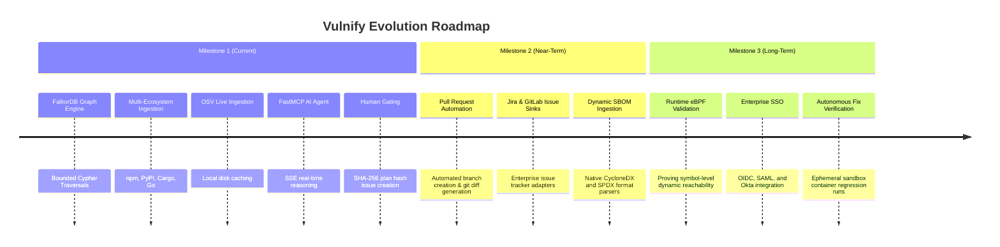

# Vulnify — Implementation Status & Product Roadmap

> **Audit of Implemented vs. Planned Capabilities, Verified Milestones, and Future Horizons**  
> *An honest, comprehensive accounting of the Vulnify platform's verified implementation and roadmap.*

---

## 1. Feature Implementation Status Matrix

The following matrix documents the verified status of all capabilities within the Vulnify codebase. Every "Verified" item is backed by passing backend pytest suites and frontend Vitest suites.

| Functional Area | Capability | Status | Implementation Evidence |
| :--- | :--- | :--- | :--- |
| **Authentication & RBAC** | Argon2id Password Hashing | **Verified** | `backend/src/vulnify/routers/auth.py`, `test_auth.py` |
| | Cookie-based Sessions (`HttpOnly`, `SameSite=Lax`) | **Verified** | `vulnify_session` cookie validation in `auth.py` |
| | Custom Header CSRF Defense (`X-Requested-With`) | **Verified** | `CSRFMiddleware` in `backend/src/vulnify/main.py` |
| | Role-Based Access Control (`admin` vs `user`) | **Verified** | Guarded routes in `routers/admin.py` |
| **Data Ingestion** | npm `package-lock.json` (v1, v2, v3) Parsing | **Verified** | `lockfile_parser.py`, `test_lockfile_parser.py` |
| | Python `requirements.txt`, `Pipfile.lock`, `poetry.lock` | **Verified** | `python_parser.py`, `test_python_parser.py` |
| | Rust `Cargo.lock` Parsing | **Verified** | `cargo_parser.py`, `test_cargo_parser.py` |
| | Go `go.mod` and `go.sum` Parsing | **Verified** | `golang_parser.py`, `test_golang_parser.py` |
| | Content Deduplication via SHA-256 Hashing | **Verified** | `ImportEvent` checks in `dependency_repository.py` |
| | Multi-Ecosystem Graph Integration | **Verified** | `test_dependency_import_multi_ecosystem.py` |
| **OSV Advisory Matching** | Batch Ingestion (`/v1/querybatch`) | **Verified** | `backend/src/vulnify/osv/client.py`, `test_osv_api.py` |
| | Disk Caching (`backend/.osv_cache`) | **Verified** | `backend/src/vulnify/osv/cache.py` |
| | Strict SemVer Version Range Evaluation | **Verified** | `semver` evaluator in `version_matching/` |
| | Strict PEP 440 Version Range Evaluation | **Verified** | `packaging` evaluator in `version_matching/` |
| **FalkorDB Graph Engine**| Redis Wire Protocol Client (`falkordb-py`) | **Verified** | `backend/src/vulnify/graph/client.py` |
| | 30+ Parameterized `.cypher` Queries | **Verified** | `backend/src/vulnify/graph/queries/` |
| | Bounded Variable Traversals (`[:DEPENDS_ON*1..8]`)| **Verified** | Hard traversal caps across all path queries |
| | Sub-50ms Graph Traversal SLA | **Verified** | Latency benchmarks in `test_findings_performance.py`|
| | Multi-Tenant Project Isolation | **Verified** | Scoped queries in `test_project_data_isolation.py` |
| **AI Investigation Agent**| Deterministic Hand-Written Agent Loop | **Verified** | `orchestrator.py` (no LangChain/LangGraph) |
| | Hard Step Limits (10) and Run Timeouts (60s) | **Verified** | Guardrails in `orchestrator.py`, `schemas.py` |
| | FastMCP Tool Registry (`mcp>=2.3.0`) | **Verified** | `backend/src/vulnify/agent/mcp_server.py` |
| | Server-Sent Events (SSE) Streaming | **Verified** | `POST /api/projects/{id}/agent/investigate` |
| | Untrusted Advisory Prompt Boundary | **Verified** | Sanitized text injection defense in `orchestrator.py`|
| **Remediation & Gating** | Deterministic Priority Scoring (P0-P3) | **Verified** | `decision_service.py`, `test_scoring_engine.py` |
| | Upgrade Candidate Discovery (Patch, Minor, Major)| **Verified** | `upgrade_candidates.py`, `test_upgrade_candidates_api.py` |
| | Forward Fix Simulation & Blast Radius | **Verified** | `fix_simulation.py`, `test_fix_simulation_api.py` |
| | Cryptographic Plan Hash Binding (SHA-256) | **Verified** | `github_service.py`, `test_github_issues_api.py` |
| | Human-Gated GitHub Issue Dispatch | **Verified** | Gated write action calling GitHub REST API |
| **Frontend UI / UX** | React 19 + TypeScript + Vite + Tailwind v4 | **Verified** | Full SPA build passing `npm run build` |
| | Interactive Canvas (`@xyflow/react`) | **Verified** | `ExplorerCanvas.tsx`, `ExplorerNodeView.tsx` |
| | WCAG 2.1 AA Accessibility Audits | **Verified** | `axe-core` tests passing in `a11y-views.test.tsx` |
| | Clean Enterprise UI (Zero user-story labels) | **Verified** | Complete codebase audit verified |

---

## 2. Known Limitations & Scope Boundaries

Honesty is a core design requirement of Vulnify. The following boundaries define the current system:

1. **Architectural Exposure vs. Runtime Exploitability**:
   - Vulnify proves whether a package is linked to a service via dependency trees and inter-service call topologies.
   - It does *not* monitor dynamic execution traces or bytecode instructions to prove that a vulnerable function symbol was invoked. Findings represent architectural attack surface exposure.
2. **Upstream OSV Disclosure Latency**:
   - Vulnify relies on public disclosures in OSV.dev and GitHub Advisory Database. Zero-day flaws not yet documented in OSV will not be flagged until published upstream.
3. **Static Manifest Scope**:
   - Ingestion depends on committed lockfiles and manifests. Dynamically downloaded binaries or runtime-installed dependencies (e.g. `pip install` inside container startup scripts) are not captured unless declared in manifests.

---

## 3. Product Roadmap

### Phase 2: Enterprise Ecosystem & Issue Sinks (Q1-Q2 2027)
- **Pull Request Automation**:
  - Extend the human-gated remediation engine to open GitHub Pull Requests directly modifying `package-lock.json` or `Cargo.lock`.
  - Generates verifiable lockfile diffs before user sign-off.
- **Enterprise Issue Trackers**:
  - Add native integrations for Jira Software and GitLab Issues using the existing cryptographic plan hash gating model.
- **Native SBOM Import / Export**:
  - Direct ingestion and export of CycloneDX (v1.5) and SPDX (v3.0) JSON documents.

### Phase 3: Runtime Reachability & Enterprise Governance (Q3-Q4 2027)
- **Runtime eBPF Telemetry Correlation**:
  - Correlate FalkorDB architectural dependency paths with runtime Linux kernel eBPF call traces.
  - Prove not only that a package is present, but whether its specific symbols and shared objects are loaded in memory.
- **Enterprise Single Sign-On (SSO)**:
  - Add native SAML 2.0 and OIDC identity provider integration for enterprise directory sync.
- **Sandboxed Fix Verification**:
  - Automatically spin up ephemeral test containers to run test suites against upgrade candidates before presenting them to the human reviewer.
