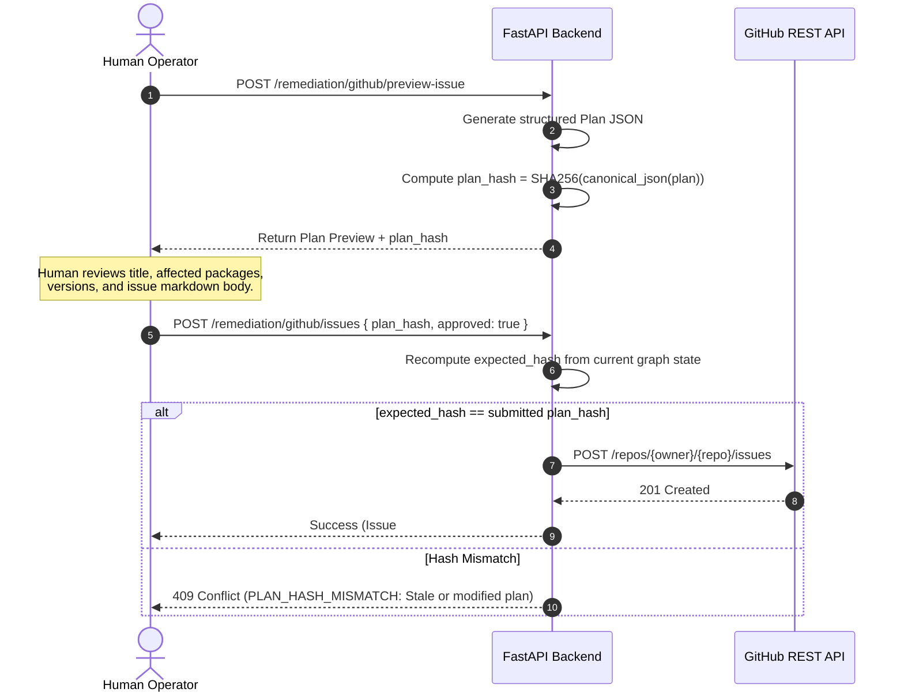

# Vulnify — Security Architecture & Threat Model

> **Threat Modeling, Authentication, Session Management, CSRF Defense, and Cryptographic Safeguards**  
> *A comprehensive specification of security controls, trust boundaries, and defense-in-depth mechanisms.*

---

## 1. Threat Model & Security Principles

Vulnify operates as a critical security tool within enterprise infrastructure. Because security platforms are themselves high-value targets, Vulnify adheres to the principle of **defense in depth** across all layers.

### 1.1 Core Security Principles
1. **Zero Implicit Trust**: User input, lockfiles, external advisory texts, and AI model responses are treated as untrusted data.
2. **Deterministic Write Gating**: Read operations are permissive; write operations affecting external state (GitHub Issues) require explicit cryptographic human approval.
3. **Fail-Closed Architecture**: If critical configuration (such as `SESSION_SECRET`) is missing or weak, the backend fails to start.
4. **Honesty & Conservative Claims**: Vulnify reports *architectural exposure* rather than claiming unverified exploitability. "No path found" is never presented as a guarantee of safety.

---

## 2. Authentication & Session Management

### 2.1 Password Hashing with Argon2id
User passwords are never stored in plaintext. Vulnify uses `argon2-cffi` to hash passwords using **Argon2id** (the hybrid variant of Argon2 combining Argon2i's side-channel resistance with Argon2d's memory-hardness against GPU attacks).
- **Time Cost (Iterations)**: 3
- **Memory Cost**: 65,536 KB (64 MB)
- **Parallelism**: 4 threads
- **Salt**: 16 cryptographically secure random bytes generated per hash.

---

### 2.2 Cookie-Based Session Security
Authentication is maintained via a cryptographically signed cookie (`vulnify_session`):
- **`HttpOnly`**: Set to `true`. JavaScript running in the browser cannot read or access the cookie, mitigating Cross-Site Scripting (XSS) token theft.
- **`SameSite=Lax`**: Defends against cross-site request forgery while allowing seamless navigation from external identity providers.
- **`Secure`**: Controlled by the `COOKIE_SECURE` environment variable. Defaults to `false` for local development, and must be set to `true` in production to enforce TLS/HTTPS transmission.
- **`Path=/`**: Restricts cookie transmission strictly to the root domain.
- **Session Expiration**: Enforced both on the client (`Max-Age`) and validated server-side against `SESSION_TTL_MINUTES` (default: 480 minutes / 8 hours).

---

### 2.3 Role-Based Access Control (RBAC)
Vulnify enforces two distinct authorization tiers:
- **`user`**: Can view projects, upload lockfiles, inspect findings, simulate fixes, and preview/open GitHub issues.
- **`admin`**: In addition to standard capabilities, administrators can configure global GitHub API credentials, manage system settings, and delete projects.

---

## 3. Cross-Site Request Forgery (CSRF) Defense

Standard cookie-based authentication is vulnerable to CSRF unless fortified by explicit anti-forgery mechanisms. Vulnify enforces a multi-layered CSRF defense implemented in `CSRFMiddleware`:

### 3.1 Custom Header Enforcement (`X-Requested-With`)
For all mutating HTTP methods (`POST`, `PUT`, `PATCH`, `DELETE`):
- The client must include the header:  
  `X-Requested-With: vulnify`
- Standard cross-origin HTML form submissions (`<form action="...">`) and cross-site scripts cannot inject custom headers across origins without triggering a CORS preflight (`OPTIONS`) check.

### 3.2 Origin Verification Whitelist
If the HTTP `Origin` header is present:
- The backend normalizes the origin and verifies it against the configured `ALLOWED_ORIGINS` list (e.g., `http://localhost:5173`).
- If the origin does not match, the request is immediately terminated with `403 Forbidden` (`CSRF_ERROR`).

---

## 4. Human-in-the-Loop Cryptographic Remediation Gate

Autonomous AI agents that modify codebases or create public bug tickets pose serious security risks (confidentiality leaks, unauthorized actions, hallucinations). Vulnify resolves this with a cryptographic plan hash binding:



The model's text is never authorization. Issue creation proceeds **only** when the user presents a matching SHA-256 hash calculated over the exact verified payload.

---

## 5. Untrusted Data Handling & Input Sanitization

Security intelligence platforms ingest untrusted data from multiple sources:

### 5.1 Advisory Texts & READMEs
- External descriptions from OSV.dev, CVE entries, and package manifests frequently contain raw HTML, Markdown, or adversarial prompts.
- **Prompt Injection Defense**: Advisory content is passed to LLMs strictly within clearly delimited, quoted data blocks (e.g. `<advisory_data>...</advisory_data>`). System prompts explicitly instruct models to treat this data as passive text rather than executable commands.
- **Frontend XSS Defense**: The frontend never uses `dangerouslySetInnerHTML`. Advisory text is rendered using standard React JSX text nodes or sanitized Markdown formatters.

### 5.2 Lockfile & Ingestion Protection
- **File Upload Limits**: Enforced via `DEPENDENCY_IMPORT_MAX_FILE_SIZE_MB` (default 10 MB). Oversized payloads are rejected before memory allocation.
- **AST / Structured Parsing**: Files are parsed via strict JSON / TOML parsers rather than running package manager executables (`npm install`, `pip install`), preventing arbitrary code execution during ingestion.
- **No Path Traversal**: Service names and uploaded filenames are sanitized; files are never written directly to the host OS filesystem outside designated temporary buffers.

---

## 6. Secrets Management & Fail-Closed Boot

1. **Centralized Configuration**: All secrets (`SESSION_SECRET`, `GITHUB_TOKEN`, LLM API keys) reside in environment variables or `.env`.
2. **Zero Hardcoded Credentials**: Source code contains no default or fallback passwords.
3. **Fail-Closed Lifespan**:
   ```python
   # backend/src/vulnify/main.py
   if not settings.SESSION_SECRET or len(settings.SESSION_SECRET) < 32:
       raise RuntimeError("Application startup aborted: SESSION_SECRET must be at least 32 characters.")
   ```
4. **Credential Masking**: Admin endpoints masking sensitive tokens (e.g., displaying `ghp_************` instead of raw secrets).
5. **Git Safety Guardrails**: `.gitignore` excludes `.env`, `*.log`, and temporary credentials.
