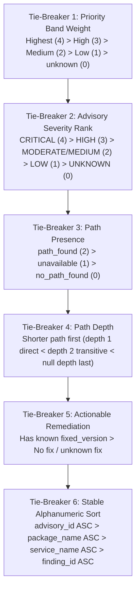

# Vulnify Scoring Policy & Priority Ranking Specification

- **Document Version:** 1.0.0
- **Policy Identifier:** `v1.0.0`
- **Applicable User Story:** US-301 (Priority Bands with Reasons)
- **Status:** Approved / Authoritative

---

## 1. Overview and Core Principles

Vulnify prioritizes security findings using a deterministic, evidence-backed scoring policy. Unlike conventional scanners that rely solely on upstream CVSS scores without architectural context, Vulnify ranks vulnerabilities by combining advisory severity with graph-proven reachability, package version constraints, remediation availability, and human triage state.

### 1.1 Non-Negotiable Tenets

1. **Exposure, Not Exploitability:**
   Dependency paths demonstrate architectural reachability and exposure from a service to a vulnerable package version. Vulnify never claims an issue is exploitable; it establishes verified exposure.
2. **Honesty Regarding Missing Signals:**
   Missing or unavailable signals are explicitly treated as `"unknown"`, never zero or absent risk. If an advisory lacks severity or if graph topology is incomplete, the system must not assign a low risk score.
3. **Absence of Path Does Not Guarantee Safety:**
   A `"no_path_found"` outcome is bounded by analyzed graph depth and traversal limits. It does not prove that an unanalyzed path does not exist.
4. **Deterministic and Explainable:**
   Identical input signals must always produce identical priority assignments, identical reason codes, and identical tie-breaking order. Every finding must explain *why* it was placed in its priority band.
5. **Backend Authority:**
   All scoring rules, priority assignment, tie-breakers, ranking order, missing-signal handling, and score-version management live in the backend. Frontends render backend calculations and must not infer or compute priorities.

---

## 2. Input Signals

The scoring engine evaluates the following discrete signals for each finding:

| Signal | Valid Values | Description | Handling when Missing/Null |
| :--- | :--- | :--- | :--- |
| **Advisory Severity** | `CRITICAL`, `HIGH`, `MODERATE`, `MEDIUM`, `LOW`, `UNKNOWN` | Upstream severity classification from OSV / CVE. | Treated as `UNKNOWN`. Never defaulted to LOW or zero risk. |
| **Version Match Status** | `affected`, `not_affected`, `unknown` | Result of ecosystem-aware semantic version constraint evaluation. | Treated as `unknown`. |
| **Path Reachability Status** | `path_found`, `no_path_found`, `unavailable` | Graph traversal outcome from service entry point to target package version. | Treated as `unavailable` (unknown reachability). |
| **Path Depth** | Integer $\ge 1$, or `null` | Shortest hop count from service root ($1 = \text{direct}$, $\ge 2 = \text{transitive}$). | Treated as `null` (unknown depth). Sorted after known depths. |
| **Remediation Target** | String (version) or `null` | Earliest known fixed version published in the advisory. | Treated as `null` ("no known fix" / unknown). |
| **Triage Status** | `open`, `under_investigation`, `affected`, `not_affected`, `fixed` | Human review state recorded by administrators. | Default: `open`. |
| **Exploitation Signal** | `true`, `false`, `null` | Known-exploited threat intelligence signal (US-302). | Default: `null` (unknown). |

---

## 3. Priority Bands

Vulnify classifies every finding into one of four standard priority bands (or `unknown` if explicitly designated):

```
+--------------------------------------------------------------------------+
|  Highest  | Critical severity + confirmed reachable dependency path     |
+-----------+--------------------------------------------------------------+
|  High     | High severity + confirmed reachable dependency path          |
|           | (or known-exploited threat signal without confirmed path)    |
+-----------+--------------------------------------------------------------+
|  Medium   | Moderate/Low severity + confirmed reachable dependency path  |
|           | OR Critical/High advisory with unconfirmed / missing path   |
|           | OR Unknown severity with confirmed dependency path           |
+-----------+--------------------------------------------------------------+
|  Low      | Confirmed no path found + Low severity                      |
|           | OR Finding resolved / confirmed not affected by triage       |
+--------------------------------------------------------------------------+
```

### 3.1 Band Definitions & Trigger Rules

#### Band 1: `Highest` Priority
- **Intent:** Urgent architectural exposure requiring immediate remediation.
- **Criteria:**
  - `match_status == "affected"`
  - `path_status == "path_found"`
  - `severity == "CRITICAL"` (or `is_known_exploited == true` with confirmed path)
  - `triage_status` is not in (`"fixed"`, `"not_affected"`)
- **Example Reasons:**
  - *"Advisory severity is Critical"*
  - *"Direct dependency reachable from service (path depth: 1 hop)"*
  - *"Installed version confirmed within affected range"*

#### Band 2: `High` Priority
- **Intent:** High-risk dependency exposure with actionable paths or imminent threat.
- **Criteria:**
  - `match_status == "affected"`
  - `path_status == "path_found"`
  - `severity == "HIGH"`
  - *(Alternatively: `is_known_exploited == true` where reachability is unconfirmed or unknown)*
  - `triage_status` is not in (`"fixed"`, `"not_affected"`)
- **Example Reasons:**
  - *"Advisory severity is High"*
  - *"Transitive dependency reachable from service (path depth: 2 hops)"*
  - *"Actionable remediation target available (fixed in >= 2.0.1)"*

#### Band 3: `Medium` Priority
- **Intent:** Moderate exposure, or high-severity advisory with unconfirmed reachability.
- **Criteria:**
  - `match_status == "affected"` AND `triage_status` not in (`"fixed"`, `"not_affected"`) AND any of:
    1. `path_status == "path_found"` AND `severity` in (`"MODERATE"`, `"MEDIUM"`, `"LOW"`)
    2. `path_status == "no_path_found"` AND `severity` in (`"CRITICAL"`, `"HIGH"`)
    3. `path_status` in (`"unavailable"`, `"unknown"`) AND `severity` in (`"CRITICAL"`, `"HIGH"`, `"MODERATE"`, `"MEDIUM"`)
    4. `path_status == "path_found"` AND `severity == "UNKNOWN"` (conservative default for unknown signal with verified reachability)
    5. `path_status == "no_path_found"` AND `severity == "UNKNOWN"` (missing severity signal prevents classification as Low)
- **Example Reasons:**
  - *"Advisory severity is Moderate/Medium"*
  - *"Dependency path confirmed reachable from service"*
  - *"No service dependency path found within analyzed traversal bounds (does not guarantee absence of risk)"*
  - *"Advisory severity is unknown (missing upstream signal; treated with caution, not zero risk)"*

#### Band 4: `Low` Priority
- **Intent:** Low severity with no reachability, or verified mitigated findings.
- **Criteria:**
  - `triage_status` in (`"fixed"`, `"not_affected"`), OR
  - `match_status == "not_affected"`, OR
  - `severity == "LOW"` AND `path_status == "no_path_found"`
- **Example Reasons:**
  - *"Finding resolved or dismissed via triage status 'fixed'"*
  - *"Advisory severity is Low"*
  - *"No service dependency path found within analyzed traversal bounds"*

#### Special Band: `unknown`
- **Intent:** Used only when an operator or test explicitly marks a priority as unassigned, or when finding evaluation is pending.
- **Criteria:** Explicit operator override or uninitialized placeholder.

---

## 4. Deterministic Tie-Breakers

When two or more findings share the same priority band, Vulnify breaks ties deterministically using the following sequential rules:



1. **Priority Band Weight (Descending):**
   `Highest` (4) > `High` (3) > `Medium` (2) > `Low` (1) > `unknown` (0).
2. **Advisory Severity Rank (Descending):**
   `CRITICAL` (4) > `HIGH` (3) > `MODERATE`/`MEDIUM` (2) > `LOW` (1) > `UNKNOWN` (0).
3. **Path Presence (Descending):**
   `path_found` (2) > `unavailable`/`unknown` (1) > `no_path_found` (0).
4. **Path Depth (Ascending):**
   Direct dependencies (depth = 1) rank before transitive dependencies (depth $\ge 2$). Unknown or null depth ranks last (`depth = 999`).
5. **Actionable Remediation (Descending):**
   Findings with a confirmed `fixed_version` rank before findings without a known fix.
6. **Stable Alphanumeric Sort (Ascending):**
   Final tie-breaker by `advisory_id` (case-insensitive), then `package_name`, then `service_name`, then `id`.

---

## 5. Explainable Reasons Specification

Every finding evaluated by the scoring engine MUST include a list of human-readable explanation strings (`priority_reasons`) and corresponding machine-readable reason codes (`reason_codes`).

### Standard Reason Codes:

| Code | Explanation Text Pattern | Category |
| :--- | :--- | :--- |
| `SEVERITY_CRITICAL` | `Advisory severity is Critical` | Severity |
| `SEVERITY_HIGH` | `Advisory severity is High` | Severity |
| `SEVERITY_MEDIUM` | `Advisory severity is Moderate/Medium` | Severity |
| `SEVERITY_LOW` | `Advisory severity is Low` | Severity |
| `SEVERITY_UNKNOWN` | `Advisory severity is unknown (missing upstream signal; treated with caution, not zero risk)` | Severity (Missing) |
| `PATH_DIRECT_REACHABLE` | `Direct dependency reachable from service (path depth: 1 hop)` | Reachability |
| `PATH_TRANSITIVE_REACHABLE` | `Transitive dependency reachable from service (path depth: {N} hops)` | Reachability |
| `PATH_CONFIRMED_REACHABLE` | `Dependency path confirmed reachable from service` | Reachability |
| `PATH_NOT_FOUND` | `No service dependency path found within analyzed traversal bounds (does not guarantee absence of risk)` | Reachability |
| `PATH_UNKNOWN` | `Dependency path reachability unknown (service topology traversal pending or unavailable; not assumed safe)` | Reachability (Missing) |
| `FIX_VERSION_AVAILABLE` | `Actionable remediation target available (fixed in >= {version})` | Remediation |
| `FIX_VERSION_UNKNOWN` | `Remediation target unknown (no published fixed version in upstream advisory)` | Remediation (Missing) |
| `TRIAGE_STATUS_RESOLVED` | `Finding resolved or dismissed via triage status '{status}'` | Triage |
| `TRIAGE_UNDER_INVESTIGATION` | `Finding currently under active security investigation` | Triage |
| `TRIAGE_NEEDS_REVIEW` | `Prior triage decision requires review: {reason}` | Triage / Change Detection (US-402) |
| `MATCH_STATUS_NOT_AFFECTED` | `Version evaluation confirmed package is not affected by advisory constraints` | Version Match |
| `KNOWN_EXPLOITED_ACTIVE` | `Known active exploitation reported in public threat intelligence` | Threat Intelligence |

---

## 5.1 Change Detection & Triage Review Lifecycle (US-402)

Under US-402 ("settled findings stay quiet unless the advisory, the version or the path changes; then it is flagged 'needs review' with the reason"):
1. When a finding is recorded as `not_affected`, an immutable snapshot of authoritative evidence (advisory severity, range, fixed version, modified date; package version identity; dependency path depth and status) is captured as a deterministic SHA-256 baseline fingerprint.
2. Settled findings stay quiet and are suppressed to `Low` priority under Rule 1 as long as the current evidence matches the recorded baseline.
3. If any of the 3 canonical dimensions changes:
   - The finding is marked `review_required = true` with a detailed human-readable `review_reason` and `change_category`.
   - Rule 1 priority suppression is bypassed: the finding is scored according to its true current risk (Highest, High, Medium) based on actual severity, exposure, and remediation signals.
   - Code `TRIAGE_NEEDS_REVIEW` is appended to `reason_codes`.
   - The finding is included in summary metrics (`findings_needing_decision`).
4. When an administrator reviews and confirms or updates the decision:
   - The `review_required` flag is cleared.
   - The baseline snapshot is advanced to the current authoritative evidence.
   - Historical decision value, original triaged timestamp, and triage actor are preserved for auditability.

---

## 6. Scoring Versioning and Immutability

1. **Version Identifier:**
   The current scoring policy version is string literal `"v1.0.0"`.
2. **Persistence:**
   Every finding response and persisted finding edge in FalkorDB includes `scoring_version`.
3. **Immutability:**
   Historical scoring records preserve the `scoring_version` under which they were generated. If scoring formulas, weights, or band thresholds are modified in future releases, a new version identifier (e.g. `v1.1.0` or `v2.0.0`) must be issued.
